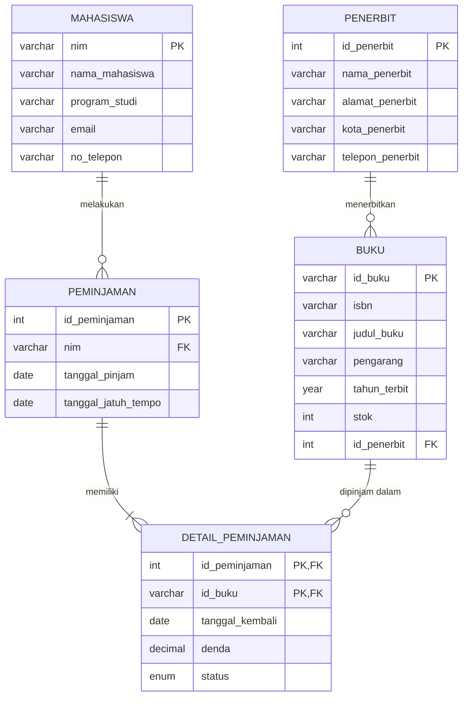
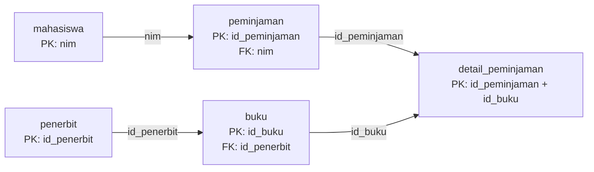

# Tugas Mandiri Modul 6 – Perancangan ERD E-Library Kampus

| Keterangan | Isi |
|---|---|
| Nama | Siti Nurauliya |
| NIM | D121241003 |
| Mata Kuliah | Pemrograman Web |
| Topik | Pemodelan Data dan Basis Data Relasional |

---

## 1. Deskripsi Skenario

Sistem **E-Library Kampus** digunakan untuk mengelola peminjaman buku perpustakaan. Sistem mencatat:

- data **mahasiswa** sebagai peminjam,
- data **buku** beserta **penerbitnya**,
- **riwayat peminjaman dan pengembalian** buku.

Aturan bisnis yang digunakan:

1. Satu mahasiswa dapat melakukan banyak transaksi peminjaman.
2. Satu transaksi peminjaman dapat memuat satu atau lebih buku.
3. Satu buku dapat dipinjam berkali-kali pada transaksi yang berbeda.
4. Satu penerbit dapat menerbitkan banyak buku, dan satu buku hanya memiliki satu penerbit.
5. Pengembalian dicatat per buku (setiap buku bisa dikembalikan pada tanggal berbeda) beserta denda keterlambatan jika ada.
6. Status buku pada transaksi: `Dipinjam` (belum kembali), `Dikembalikan` (kembali tepat waktu), `Terlambat` (kembali melewati jatuh tempo).
7. Denda keterlambatan dihitung **Rp1.000 per hari per buku** sejak lewat tanggal jatuh tempo (contoh: buku B02 terlambat 2 hari, denda Rp2.000).

**Catatan penulisan:** pada seluruh dokumen, **huruf tebal** menandai Primary Key (PK), *huruf miring* menandai Foreign Key (FK), dan ***tebal-miring*** menandai atribut yang sekaligus PK dan FK.

---


## 2. Identifikasi Entitas dan Atribut

### 2.1 Mahasiswa
| Atribut | Keterangan | Kunci |
|---|---|---|
| nim | Nomor induk mahasiswa | **PK** |
| nama_mahasiswa | Nama lengkap | |
| program_studi | Program studi | |
| email | Email mahasiswa | |
| no_telepon | Nomor telepon | |

### 2.2 Penerbit
| Atribut | Keterangan | Kunci |
|---|---|---|
| id_penerbit | Identitas penerbit | **PK** |
| nama_penerbit | Nama penerbit | |
| alamat_penerbit | Alamat penerbit | |
| kota_penerbit | Kota penerbit | |
| telepon_penerbit | Telepon penerbit | |

### 2.3 Buku
| Atribut | Keterangan | Kunci |
|---|---|---|
| id_buku | Kode unik buku | **PK** |
| isbn | Nomor ISBN | |
| judul_buku | Judul buku | |
| pengarang | Nama pengarang | |
| tahun_terbit | Tahun terbit | |
| stok | Jumlah eksemplar tersedia | |
| id_penerbit | Penerbit buku | **FK** → Penerbit |

### 2.4 Transaksi Peminjaman
Entitas ini diwujudkan dalam dua tabel: **Peminjaman** (header) dan **Detail_Peminjaman** (rincian buku), karena hubungan antara transaksi dan buku adalah *many-to-many* (satu transaksi memuat banyak buku, satu buku dipinjam di banyak transaksi).

**Peminjaman**

| Atribut | Keterangan | Kunci |
|---|---|---|
| id_peminjaman | Nomor transaksi | **PK** |
| nim | Mahasiswa peminjam | **FK** → Mahasiswa |
| tanggal_pinjam | Tanggal transaksi | |
| tanggal_jatuh_tempo | Batas pengembalian | |

**Detail_Peminjaman**

| Atribut | Keterangan | Kunci |
|---|---|---|
| id_peminjaman | Nomor transaksi | **PK, FK** → Peminjaman |
| id_buku | Buku yang dipinjam | **PK, FK** → Buku |
| tanggal_kembali | Tanggal buku dikembalikan (NULL jika belum) | |
| denda | Denda keterlambatan | |
| status | Dipinjam / Dikembalikan / Terlambat | |

---


## 3. Simulasi Normalisasi

Seluruh tahap normalisasi memakai **data contoh yang sama** dengan data pada tabel akhir (bagian 7).

### 3.1 UNF (Unnormalized Form)

Data mentah dari formulir peminjaman. Terdapat **kelompok data berulang** (data buku dan penerbit, ditandai `{ }`).

```
Peminjaman(
  id_peminjaman, tanggal_pinjam, tanggal_jatuh_tempo,
  nim, nama_mahasiswa, program_studi, email, no_telepon,
  { id_buku, isbn, judul_buku, pengarang, tahun_terbit, stok,
    id_penerbit, nama_penerbit, alamat_penerbit, kota_penerbit, telepon_penerbit,
    tanggal_kembali, denda, status }
)
```

Contoh data UNF:

| id_peminjaman | tanggal_pinjam | tanggal_jatuh_tempo | nim | nama_mahasiswa | program_studi | buku yang dipinjam |
|---|---|---|---|---|---|---|
| 1 | 2026-09-01 | 2026-09-08 | 2401001 | Andi Saputra | Informatika | B01 Basis Data (penerbit 1: Penerbit Informatika, Bandung); B02 Algoritma dan Pemrograman (penerbit 2: Erlangga, Jakarta) |
| 2 | 2026-09-03 | 2026-09-10 | 2401002 | Siti Rahma | Sistem Informasi | B01 Basis Data (penerbit 1: Penerbit Informatika, Bandung) |

Masalah: satu sel berisi lebih dari satu buku (*repeating group*).

### 3.2 1NF (First Normal Form)

Syarat: setiap atribut **atomik** dan **tidak ada kelompok berulang**. Setiap buku dalam satu transaksi dijadikan baris tersendiri, sehingga Primary Key menjadi **(id_peminjaman, id_buku)**.

Skema 1NF:

```
Peminjaman_1NF(
  id_peminjaman (PK), id_buku (PK),
  tanggal_pinjam, tanggal_jatuh_tempo,
  nim, nama_mahasiswa, program_studi, email, no_telepon,
  isbn, judul_buku, pengarang, tahun_terbit, stok,
  id_penerbit, nama_penerbit, alamat_penerbit, kota_penerbit, telepon_penerbit,
  tanggal_kembali, denda, status
)
```

Contoh data 1NF (bagian 1 dari 3: data transaksi dan mahasiswa):

| **id_peminjaman** | **id_buku** | tanggal_pinjam | tanggal_jatuh_tempo | nim | nama_mahasiswa | program_studi | email | no_telepon |
|---|---|---|---|---|---|---|---|---|
| 1 | B01 | 2026-09-01 | 2026-09-08 | 2401001 | Andi Saputra | Informatika | andi@kampus.ac.id | 081234567001 |
| 1 | B02 | 2026-09-01 | 2026-09-08 | 2401001 | Andi Saputra | Informatika | andi@kampus.ac.id | 081234567001 |
| 2 | B01 | 2026-09-03 | 2026-09-10 | 2401002 | Siti Rahma | Sistem Informasi | siti@kampus.ac.id | 081234567002 |

Bagian 2 dari 3: data buku dan penerbit (baris sama, urutan sama):

| **id_peminjaman** | **id_buku** | isbn | judul_buku | pengarang | tahun_terbit | stok | id_penerbit | nama_penerbit | alamat_penerbit | kota_penerbit | telepon_penerbit |
|---|---|---|---|---|---|---|---|---|---|---|---|
| 1 | B01 | 9786020000011 | Basis Data | Rahmat Hidayat | 2020 | 5 | 1 | Penerbit Informatika | Jl. Geger Kalong No. 10 | Bandung | 022-1234567 |
| 1 | B02 | 9786020000028 | Algoritma dan Pemrograman | Dewi Lestari | 2019 | 3 | 2 | Erlangga | Jl. H. Baping Raya No. 100 | Jakarta | 021-7654321 |
| 2 | B01 | 9786020000011 | Basis Data | Rahmat Hidayat | 2020 | 5 | 1 | Penerbit Informatika | Jl. Geger Kalong No. 10 | Bandung | 022-1234567 |

Bagian 3 dari 3: data pengembalian:

| **id_peminjaman** | **id_buku** | tanggal_kembali | denda | status |
|---|---|---|---|---|
| 1 | B01 | 2026-09-07 | 0 | Dikembalikan |
| 1 | B02 | 2026-09-10 | 2000 | Terlambat |
| 2 | B01 | NULL | 0 | Dipinjam |

Masalah yang masih ada: **redundansi**. Data Andi Saputra tertulis 2 kali, data buku B01 dan Penerbit Informatika juga tertulis 2 kali. Hal ini rawan anomali *insert*, *update*, dan *delete*.


### 3.3 2NF (Second Normal Form)

Syarat: sudah 1NF dan **tidak ada ketergantungan parsial** (atribut non-kunci bergantung pada sebagian kunci komposit saja).

Analisis ketergantungan fungsional terhadap PK **(id_peminjaman, id_buku)**:

| Ketergantungan | Jenis |
|---|---|
| id_peminjaman → tanggal_pinjam, tanggal_jatuh_tempo, nim, nama_mahasiswa, program_studi, email, no_telepon | Parsial |
| id_buku → isbn, judul_buku, pengarang, tahun_terbit, stok, id_penerbit, nama_penerbit, alamat_penerbit, kota_penerbit, telepon_penerbit | Parsial |
| (id_peminjaman, id_buku) → tanggal_kembali, denda, status | Penuh |

Hasil dekomposisi 2NF:

- **Peminjaman**(**id_peminjaman**, tanggal_pinjam, tanggal_jatuh_tempo, nim, nama_mahasiswa, program_studi, email, no_telepon)
- **Buku**(**id_buku**, isbn, judul_buku, pengarang, tahun_terbit, stok, id_penerbit, nama_penerbit, alamat_penerbit, kota_penerbit, telepon_penerbit)
- **Detail_Peminjaman**(***id_peminjaman***, ***id_buku***, tanggal_kembali, denda, status)

Setelah 2NF, data Andi Saputra cukup tertulis sekali per transaksi dan data buku B01 hanya satu baris. Namun masih ada redundansi data mahasiswa (jika Andi punya banyak transaksi) dan data penerbit (jika penerbit punya banyak buku).

### 3.4 3NF (Third Normal Form)

Syarat: sudah 2NF dan **tidak ada ketergantungan transitif** (atribut non-kunci bergantung pada atribut non-kunci lain).

| Ketergantungan transitif | Penyelesaian |
|---|---|
| id_peminjaman → nim → nama_mahasiswa, program_studi, email, no_telepon | Pisahkan tabel **Mahasiswa**; `nim` tetap di Peminjaman sebagai FK |
| id_buku → id_penerbit → nama_penerbit, alamat_penerbit, kota_penerbit, telepon_penerbit | Pisahkan tabel **Penerbit**; `id_penerbit` tetap di Buku sebagai FK |

Hasil akhir **3NF**:

- **Mahasiswa**(**nim**, nama_mahasiswa, program_studi, email, no_telepon)
- **Penerbit**(**id_penerbit**, nama_penerbit, alamat_penerbit, kota_penerbit, telepon_penerbit)
- **Buku**(**id_buku**, isbn, judul_buku, pengarang, tahun_terbit, stok, *id_penerbit*)
- **Peminjaman**(**id_peminjaman**, *nim*, tanggal_pinjam, tanggal_jatuh_tempo)
- **Detail_Peminjaman**(***id_peminjaman***, ***id_buku***, tanggal_kembali, denda, status)

Setiap atribut non-kunci kini hanya bergantung pada kunci tabelnya, sehingga tidak ada redundansi dan anomali data.

---


## 4. Rancangan Tabel Akhir

### 4.1 Tabel `mahasiswa`

| Kolom | Tipe Data | Kunci | Constraint | Keterangan |
|---|---|---|---|---|
| nim | VARCHAR(15) | PK | NOT NULL | Nomor induk mahasiswa |
| nama_mahasiswa | VARCHAR(100) | | NOT NULL | Nama lengkap |
| program_studi | VARCHAR(60) | | NOT NULL | Program studi |
| email | VARCHAR(100) | | UNIQUE, NOT NULL | Email |
| no_telepon | VARCHAR(15) | | NULL | Nomor telepon |

### 4.2 Tabel `penerbit`

| Kolom | Tipe Data | Kunci | Constraint | Keterangan |
|---|---|---|---|---|
| id_penerbit | INT AUTO_INCREMENT | PK | NOT NULL | Identitas penerbit |
| nama_penerbit | VARCHAR(100) | | NOT NULL | Nama penerbit |
| alamat_penerbit | VARCHAR(255) | | NULL | Alamat |
| kota_penerbit | VARCHAR(50) | | NULL | Kota |
| telepon_penerbit | VARCHAR(15) | | NULL | Telepon |

### 4.3 Tabel `buku`

| Kolom | Tipe Data | Kunci | Constraint | Keterangan |
|---|---|---|---|---|
| id_buku | VARCHAR(10) | PK | NOT NULL | Kode buku |
| isbn | VARCHAR(20) | | UNIQUE, NOT NULL | Nomor ISBN |
| judul_buku | VARCHAR(200) | | NOT NULL | Judul |
| pengarang | VARCHAR(100) | | NOT NULL | Pengarang |
| tahun_terbit | YEAR | | NOT NULL | Tahun terbit |
| stok | INT | | NOT NULL, DEFAULT 0, CHECK (stok >= 0) | Eksemplar tersedia |
| id_penerbit | INT | FK | NOT NULL | Referensi `penerbit.id_penerbit` |

### 4.4 Tabel `peminjaman`

| Kolom | Tipe Data | Kunci | Constraint | Keterangan |
|---|---|---|---|---|
| id_peminjaman | INT AUTO_INCREMENT | PK | NOT NULL | Nomor transaksi |
| nim | VARCHAR(15) | FK | NOT NULL | Referensi `mahasiswa.nim` |
| tanggal_pinjam | DATE | | NOT NULL | Tanggal pinjam |
| tanggal_jatuh_tempo | DATE | | NOT NULL | Batas pengembalian |

### 4.5 Tabel `detail_peminjaman`

| Kolom | Tipe Data | Kunci | Constraint | Keterangan |
|---|---|---|---|---|
| id_peminjaman | INT | PK, FK | NOT NULL | Referensi `peminjaman.id_peminjaman` |
| id_buku | VARCHAR(10) | PK, FK | NOT NULL | Referensi `buku.id_buku` |
| tanggal_kembali | DATE | | NULL | Kosong jika belum kembali |
| denda | DECIMAL(10,2) | | NOT NULL, DEFAULT 0 | Denda keterlambatan |
| status | ENUM('Dipinjam','Dikembalikan','Terlambat') | | NOT NULL, DEFAULT 'Dipinjam' | Status buku |

---

## 5. Relasi Antar Tabel

| Relasi | Kardinalitas | Foreign Key |
|---|---|---|
| Penerbit → Buku | 1 : N | `buku.id_penerbit` → `penerbit.id_penerbit` |
| Mahasiswa → Peminjaman | 1 : N | `peminjaman.nim` → `mahasiswa.nim` |
| Peminjaman → Detail_Peminjaman | 1 : N | `detail_peminjaman.id_peminjaman` → `peminjaman.id_peminjaman` |
| Buku → Detail_Peminjaman | 1 : N | `detail_peminjaman.id_buku` → `buku.id_buku` |
| Peminjaman ↔ Buku | M : N | diselesaikan oleh `detail_peminjaman` |

---


## 6. Diagram ERD (Mermaid)



### Diagram Alur Relasi Kunci



---


## 7. Implementasi SQL

### 7.1 DDL (Pembuatan Tabel)

```sql
CREATE DATABASE IF NOT EXISTS elibrary_kampus;
USE elibrary_kampus;

CREATE TABLE mahasiswa (
    nim             VARCHAR(15)  PRIMARY KEY,
    nama_mahasiswa  VARCHAR(100) NOT NULL,
    program_studi   VARCHAR(60)  NOT NULL,
    email           VARCHAR(100) NOT NULL UNIQUE,
    no_telepon      VARCHAR(15)
);

CREATE TABLE penerbit (
    id_penerbit      INT AUTO_INCREMENT PRIMARY KEY,
    nama_penerbit    VARCHAR(100) NOT NULL,
    alamat_penerbit  VARCHAR(255),
    kota_penerbit    VARCHAR(50),
    telepon_penerbit VARCHAR(15)
);

CREATE TABLE buku (
    id_buku       VARCHAR(10)  PRIMARY KEY,
    isbn          VARCHAR(20)  NOT NULL UNIQUE,
    judul_buku    VARCHAR(200) NOT NULL,
    pengarang     VARCHAR(100) NOT NULL,
    tahun_terbit  YEAR         NOT NULL,
    stok          INT          NOT NULL DEFAULT 0 CHECK (stok >= 0),
    id_penerbit   INT          NOT NULL,
    CONSTRAINT fk_buku_penerbit
        FOREIGN KEY (id_penerbit) REFERENCES penerbit(id_penerbit)
        ON UPDATE CASCADE ON DELETE RESTRICT
);

CREATE TABLE peminjaman (
    id_peminjaman        INT AUTO_INCREMENT PRIMARY KEY,
    nim                  VARCHAR(15) NOT NULL,
    tanggal_pinjam       DATE        NOT NULL,
    tanggal_jatuh_tempo  DATE        NOT NULL,
    CONSTRAINT fk_peminjaman_mahasiswa
        FOREIGN KEY (nim) REFERENCES mahasiswa(nim)
        ON UPDATE CASCADE ON DELETE RESTRICT
);

CREATE TABLE detail_peminjaman (
    id_peminjaman    INT         NOT NULL,
    id_buku          VARCHAR(10) NOT NULL,
    tanggal_kembali  DATE,
    denda            DECIMAL(10,2) NOT NULL DEFAULT 0,
    status           ENUM('Dipinjam','Dikembalikan','Terlambat')
                     NOT NULL DEFAULT 'Dipinjam',
    PRIMARY KEY (id_peminjaman, id_buku),
    CONSTRAINT fk_detail_peminjaman
        FOREIGN KEY (id_peminjaman) REFERENCES peminjaman(id_peminjaman)
        ON UPDATE CASCADE ON DELETE CASCADE,
    CONSTRAINT fk_detail_buku
        FOREIGN KEY (id_buku) REFERENCES buku(id_buku)
        ON UPDATE CASCADE ON DELETE RESTRICT
);
```

### 7.2 DML (Data Contoh)

Data berikut sama dengan data contoh pada simulasi normalisasi (bagian 3). Urutan `INSERT` mengikuti ketergantungan FK: tabel induk lebih dulu.

```sql
INSERT INTO mahasiswa (nim, nama_mahasiswa, program_studi, email, no_telepon) VALUES
('2401001', 'Andi Saputra', 'Informatika',      'andi@kampus.ac.id', '081234567001'),
('2401002', 'Siti Rahma',   'Sistem Informasi', 'siti@kampus.ac.id', '081234567002');

INSERT INTO penerbit (id_penerbit, nama_penerbit, alamat_penerbit, kota_penerbit, telepon_penerbit) VALUES
(1, 'Penerbit Informatika', 'Jl. Geger Kalong No. 10',   'Bandung', '022-1234567'),
(2, 'Erlangga',             'Jl. H. Baping Raya No. 100', 'Jakarta', '021-7654321');

INSERT INTO buku (id_buku, isbn, judul_buku, pengarang, tahun_terbit, stok, id_penerbit) VALUES
('B01', '9786020000011', 'Basis Data',                'Rahmat Hidayat', 2020, 5, 1),
('B02', '9786020000028', 'Algoritma dan Pemrograman', 'Dewi Lestari',   2019, 3, 2);

INSERT INTO peminjaman (id_peminjaman, nim, tanggal_pinjam, tanggal_jatuh_tempo) VALUES
(1, '2401001', '2026-09-01', '2026-09-08'),
(2, '2401002', '2026-09-03', '2026-09-10');

INSERT INTO detail_peminjaman (id_peminjaman, id_buku, tanggal_kembali, denda, status) VALUES
(1, 'B01', '2026-09-07', 0,    'Dikembalikan'),
(1, 'B02', '2026-09-10', 2000, 'Terlambat'),
(2, 'B01', NULL,         0,    'Dipinjam');
```

### 7.3 Contoh Query Verifikasi

Query berikut menggabungkan kelima tabel dan menampilkan data yang sama dengan data 1NF pada bagian 3.2.

```sql
SELECT p.id_peminjaman, m.nama_mahasiswa, b.judul_buku,
       pb.nama_penerbit, p.tanggal_pinjam, d.tanggal_kembali,
       d.denda, d.status
FROM peminjaman p
JOIN mahasiswa m          ON m.nim = p.nim
JOIN detail_peminjaman d  ON d.id_peminjaman = p.id_peminjaman
JOIN buku b               ON b.id_buku = d.id_buku
JOIN penerbit pb          ON pb.id_penerbit = b.id_penerbit
ORDER BY p.id_peminjaman, b.id_buku;
```

---

## 8. Kesimpulan

Rancangan basis data E-Library Kampus dinormalisasi dari UNF hingga **3NF** menjadi lima tabel: `mahasiswa`, `penerbit`, `buku`, `peminjaman`, dan `detail_peminjaman`. Pada tahap 1NF kelompok data berulang dipecah per baris, pada 2NF ketergantungan parsial terhadap kunci komposit dihilangkan, dan pada 3NF ketergantungan transitif (mahasiswa dan penerbit) dipisahkan ke tabel tersendiri. Tabel `detail_peminjaman` menyelesaikan relasi many-to-many antara transaksi dan buku sekaligus mencatat pengembalian dan denda per buku.

## Referensi

- Dokumentasi Mermaid, Entity Relationship Diagram: https://mermaid.js.org/syntax/entityRelationshipDiagram.html